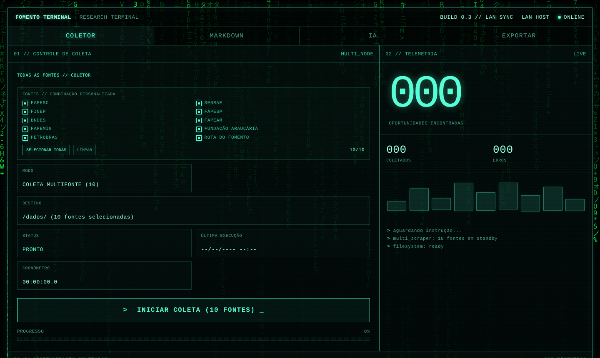
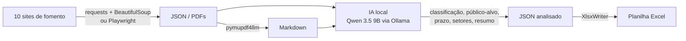
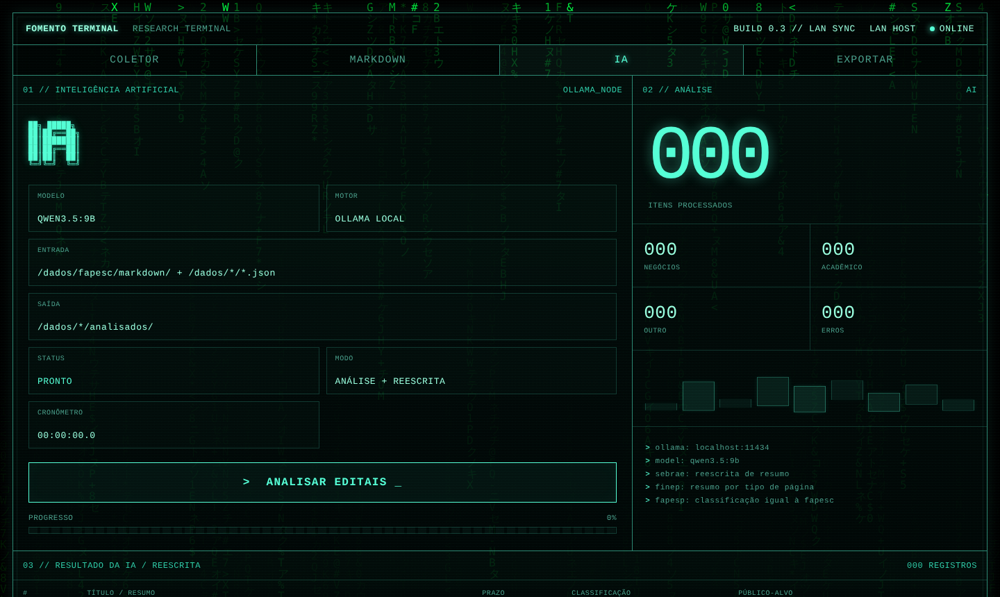
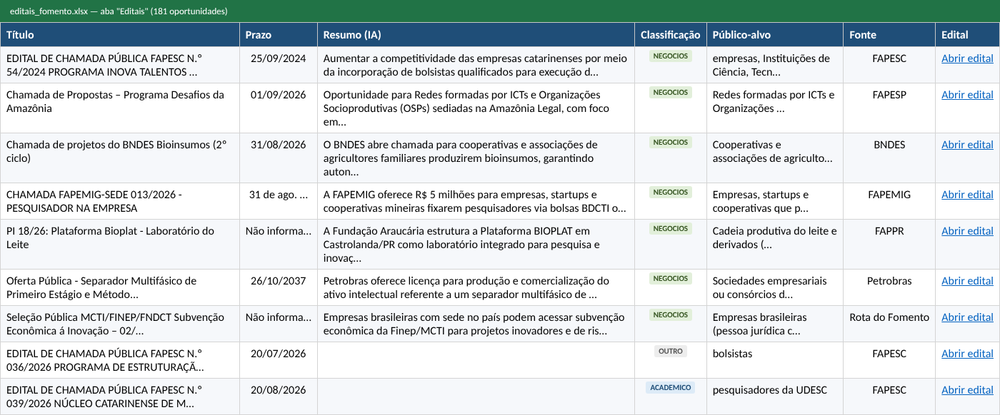

# Fomento Terminal — coletor de editais de fomento com IA local

Acompanhar editais de fomento à inovação no Brasil significa abrir dezenas de sites diferentes, ler PDFs longos e descobrir, edital por edital, **quem pode participar**. O Fomento Terminal automatiza esse trabalho: coleta oportunidades de **10 fontes**, extrai o texto dos editais, usa um **modelo de IA rodando localmente** para classificar e resumir cada um e entrega tudo numa **planilha Excel** pronta para triagem.



## O que ele faz



O painel web tem quatro etapas, cada uma com telemetria ao vivo:

| Etapa | O que acontece |
|---|---|
| **Coletor** | Escolha as fontes e rode a coleta. Sites estáticos usam `requests` + `BeautifulSoup`; sites que dependem de JavaScript (filtros, cards dinâmicos) usam **Playwright** com um navegador real. Há cache para não baixar de novo o que já foi coletado. |
| **Markdown** | Os PDFs dos editais da FAPESC são convertidos em Markdown com `pymupdf4llm`, deixando o texto pronto para a IA. |
| **IA** | Um modelo local (Qwen 3.5 9B no Ollama) identifica **quem pode submeter**, classifica o edital, extrai público-alvo e prazo, marca setores e escreve um resumo curto. Nada é enviado para APIs externas. |
| **Exportar** | Gera `editais_fomento.xlsx` com título, prazo, resumo, classificação, marcação de startups, setores, público-alvo, fonte, data de coleta e links para a página e o PDF do edital. |



## Fontes cobertas

| Fonte | Técnica |
|---|---|
| FAPESC (SC) | requests + BeautifulSoup, download de PDFs |
| FINEP | Playwright (filtros via JavaScript) |
| FAPESP (SP) | requests + BeautifulSoup |
| BNDES | requests + BeautifulSoup |
| FAPEAM (AM) | Playwright |
| FAPEMIG (MG) | Playwright |
| Fundação Araucária (PR) | requests + BeautifulSoup |
| Petrobras – Conexões para Inovação | Playwright |
| Sebrae Startups | Playwright |
| Rota do Fomento | requests + BeautifulSoup |

## Como a IA classifica

A regra central é identificar **quem pode participar/submeter**, não quem é a instituição parceira:

- **NEGÓCIOS**: empresas, startups, ICTs ou centros de inovação podem submeter (inclui pesquisador + empresa e pesquisador + ICT).
- **ACADÊMICO**: oportunidade exclusiva para pesquisadores, docentes, estudantes ou universidades.
- **OUTRO**: seleção individual de bolsistas, pessoas físicas, servidores ou casos sem público empresarial claro.

Além da classificação, a planilha tem a coluna **Startups**: todo edital que menciona startups no título, resumo, público-alvo ou evidência da classificação recebe a marca `Startups` (menções negadas, como "não são startups", são ignoradas). Essa marcação é feita na exportação, então vale também para editais já analisados.

Para economizar processamento, o resumo com IA só é gerado para editais **NEGÓCIOS**. A classificação combina regras por palavras-chave com o modelo. O critério completo está em [`criterio_classificacao.txt`](criterio_classificacao.txt).

## Exemplo de resultado

Trecho real da planilha exportada (181 oportunidades de 9 fontes):



Arquivos de exemplo em [`exemplos/`](exemplos/): a planilha completa e o JSON analisado da FINEP.

## Tecnologias

- **Python**: Flask, requests, BeautifulSoup4, Playwright, pymupdf4llm, XlsxWriter
- **IA local**: Ollama + Qwen 3.5 9B (contexto de 8k tokens)
- **Frontend**: HTML, CSS e JavaScript puros, com tema de terminal e animação estilo Matrix
- **Backend**: API REST com jobs em thread, uma operação pesada por vez e acompanhamento por polling

O servidor escuta na rede local: outros dispositivos (o celular, por exemplo) podem abrir o painel pelo IP do computador e acompanhar o mesmo processo em tempo real.

## Estrutura

```
├── backend/server.py        # API Flask, fila de jobs e rotas
├── scrappers/               # um coletor por fonte + cache_utils
├── services/
│   ├── pdf_md.py            # PDF -> Markdown
│   ├── ia.py                # classificação e resumo com Ollama
│   └── excel.py             # exportação para .xlsx
├── index.html, css/, js/    # painel web
├── exemplos/                # saída de exemplo
└── *.bat                    # atalhos para Windows
```

Os dados coletados são gravados em `dados/` (fora do controle de versão) e recriados a cada execução.

## Como rodar

**Pré-requisitos:** Python 3.10+ e [Ollama](https://ollama.com) instalado.

```bash
git clone https://github.com/yugoynn/scraper-editais-fomento.git
cd scraper-editais-fomento

python -m venv .venv
# Windows: .venv\Scripts\activate    |    Linux/macOS: source .venv/bin/activate

pip install -r requirements.txt
playwright install chromium
ollama pull qwen3.5:9b

python backend/server.py
```

Abra **http://127.0.0.1:5000**. No Windows, também dá para usar os atalhos: `CONFIGURAR_IA_QWEN35_9B.bat` (uma vez) e depois `INICIAR_PROJETO.bat`.

> A coleta funciona sem o Ollama; ele só é necessário na etapa de IA.

### API

| Método | Rota | Descrição |
|---|---|---|
| `POST` | `/api/jobs/coleta` | Inicia a coleta (`{"fontes": ["finep", "bndes"]}` ou `["todos"]`) |
| `POST` | `/api/jobs/markdown` | Converte os PDFs da FAPESC em Markdown |
| `POST` | `/api/jobs/ia` | Roda a análise com IA nas fontes escolhidas |
| `POST` | `/api/jobs/exportar` | Gera a planilha Excel |
| `GET` | `/api/jobs/<id>` | Progresso e telemetria do job |
| `GET` | `/api/jobs/<id>/arquivo` | Baixa a planilha gerada |
| `GET` | `/api/estado` | Mostra se há um job em andamento |

## Uso responsável

Este projeto foi feito para estudo e uso pessoal. Os coletores só leem páginas públicas, e a maioria faz pausas entre requisições. Alguns sites (como a FINEP) indicam no `robots.txt` que preferem não receber acesso automatizado: respeite os termos de cada site, rode com moderação e confirme sempre as informações no edital oficial. Os resumos são gerados por IA e podem conter erros.

## Próximos passos

- [x] Testes automatizados para os coletores
- [x] Rodar a coleta automaticamente (agendamento diário)
- [ ] Docker para facilitar a instalação
- [ ] Dividir `services/ia.py` em módulos por fonte

## Autor

Feito por **Danilo Pires de Oliveira** — [LinkedIn](https://www.linkedin.com/in/yugoynn/)

Licença [MIT](LICENSE).
